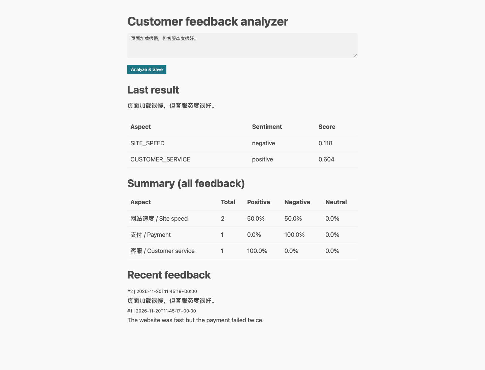

<div align="center">

# Flight Feedback Aspect Sentiment

**Bilingual aspect detection and sentiment analysis for flight-booking feedback.**

Zero-shot NLI with Chinese/English keyword support, Transformer + SnowNLP sentiment ensembles, SQLite persistence, a Flask Web UI, CLI workflows, dataset import, and evaluation tools.

[](https://www.python.org/)
[](https://huggingface.co/docs/transformers/index)
[](https://flask.palletsprojects.com/)
[](#6-verification)

[Overview](#1-overview) · [Architecture](#2-processing-pipeline) · [Quick Start](#3-quick-start) · [CLI](#4-cli-workflows) · [Verification](#6-verification) · [Limitations](#7-limitations)

</div>

---



## 1. Overview

This system analyzes flight-booking feedback across multiple service aspects rather than assigning only one sentiment to an entire review. It detects booking flow, site speed, customer service, price transparency, flight options, payment, refund/change, and other topics, then stores aspect-level sentiment for aggregate reporting.

The public edition preserves the team's engineering work while using fictional bilingual sample data. The original review database and recovered comment dataset are not redistributed.

## 2. Processing Pipeline

```text
CLI or Flask input
  → Zero-shot NLI candidates + bilingual keyword evidence
  → Near-top-score filtering and deterministic fallback
  → Contrast-aware clause segmentation
  → Chinese / English Transformer + SnowNLP weighted sentiment
  → SQLite feedback and aspect-opinion tables
  → Aspect-level statistics in the CLI, Web UI, and JSON API
```

The aspect detector combines NLI with explicit keyword evidence. Candidates close to the best NLI score are retained before adding lexical matches. If the model is unavailable, a deterministic lexicon fallback remains available. English `but` and Chinese contrast markers split clauses so opposing opinions can be evaluated in their own context.

## 3. Quick Start

### Requirements

- Python 3.12.
- Approximately 1.3 GB of model weights on first use, plus disk space for the Python environment.
- Internet access for the initial Hugging Face download.

```bash
git clone https://github.com/Cjj040721/Flight-Feedback-Aspect-Sentiment.git
cd Flight-Feedback-Aspect-Sentiment
python3.12 -m venv .venv
source .venv/bin/activate          # Windows: .venv\Scripts\activate
pip install -r requirements.txt
```

Models are stored in `~/.cache/huggingface` by default. Override the cache location when needed:

```bash
export HF_HOME=/path/to/huggingface-cache
```

### Start the Web UI

```bash
python run_server.py
```

Open `http://127.0.0.1:5000`. The server preloads models, uses CPU inference, disables tokenizer parallelism, and starts Flask without the debug reloader.

## 4. CLI Workflows

```bash
python app.py add "The website was fast but the payment failed twice."
python app.py add "页面加载很慢，但客服态度很好。"
python app.py list --limit 5
python app.py summary
```

Verified output for the English example:

```text
SITE_SPEED        positive  score=0.798
PAYMENT           negative  score=0.200
```

Verified output for the Chinese example:

```text
SITE_SPEED        negative  score=0.118
CUSTOMER_SERVICE  positive  score=0.604
```

Import a long-form CSV or JSONL dataset:

```bash
python app.py load-dataset data/sample_feedback.csv
python app.py summary
```

`data/sample_feedback.csv` contains six fictional reviews and twelve aspect-level gold labels. Resetting the database is destructive:

```bash
python app.py reset
```

## 5. Evaluation and JSON API

Run the evaluation script on the included fictional sample:

```bash
python evaluate_sentiment.py
```

The current functional check produces `4/6` correct majority-label predictions. This is a tiny sample used to verify the evaluation path, **not a meaningful model-quality benchmark**.

To evaluate another locally available long-form CSV:

```bash
python evaluate_sentiment.py /path/to/reviews_multi_aspect_merged_long.csv
```

With the server running, aggregated statistics are also available at:

```text
GET /api/summary
```

## 6. Verification

| Check | Result |
|---|---|
| Unit and regression tests | **8 passed** |
| Zero-shot behavior | NLI prediction retained without a keyword match; near-top filtering tested |
| Fallback behavior | Model failure falls back to bilingual keywords; `fast` does not match `breakfast` |
| Contrast handling | English `but` separates positive website feedback from failed payment |
| Real model loading | mDeBERTa XNLI, Chinese RoBERTa, and English DistilBERT loaded successfully |
| Real CLI | English and Chinese submission, recent history, and aggregate statistics passed |
| Real Web workflow | Browser submissions returned the same aspect labels and scores as the CLI |
| JSON API | `/api/summary` returned persisted aspect counts |
| Screenshots | Captured from the actual Flask responses, not a mock interface |

See [`docs/VALIDATION.md`](docs/VALIDATION.md) for the detailed evidence and fixes made during cleanup.

## 7. Limitations

- Sentiment models are general-purpose classifiers, not flight-domain fine-tuned models.
- The evaluation script derives review-level labels by majority vote across aspect labels; it is not a full aspect-level precision/recall/F1 evaluation.
- Lexicon rules still influence final aspect selection and can miss paraphrases or introduce domain-specific ambiguity.
- The original dataset's redistribution terms were not confirmed, so it is not included.
- The original report's approximate accuracy was marked as a placeholder and is not reproduced as a verified result.
- Flask's development server is used for local demonstration, not production deployment.

## 8. Team and Third-Party Notices

This was a team coursework project. The team authorized public release with other members kept anonymous. Cao Junjia's documented responsibilities were overall architecture, core modules, integration, major debugging, and chief report editing; see [`docs/TEAM.md`](docs/TEAM.md).

Third-party models and services remain subject to their original terms. See [`THIRD_PARTY_NOTICES.md`](THIRD_PARTY_NOTICES.md). No license is granted for third-party models, course materials, or the recovered comment dataset.

---

<div align="center">

**Flight Feedback Aspect Sentiment — Detect the aspect. Read the contrast. Aggregate the evidence.**

Python · Transformers · SnowNLP · SQLite · Flask

</div>
